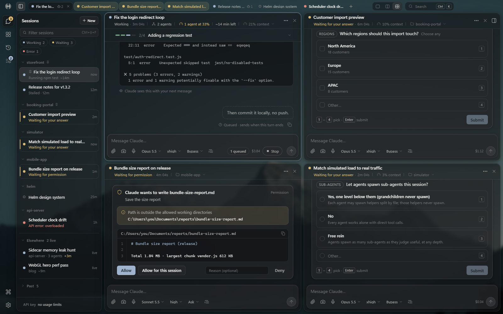

# Helm

A desktop app (and phone page) for Claude Code: your Claude Code sessions in a real window, with a
sidebar, readable conversations, agent and usage panels, and the same UI on your phone.



*Helm's own UI rendered in its mock mode (`node tools/serve-ui.js`, then `?mock=1`). The projects, sessions,
messages and costs are sample data from `ui/lib/mock-data.js`.*

Helm does not reimplement Claude. Every session is the real Claude Code CLI that **you install
yourself**, driven through Anthropic's Claude Agent SDK. Your `CLAUDE.md` files, memory, hooks, MCP
servers and skills work exactly as they do in the terminal. Helm only replaces the terminal screen:
a sidebar of sessions, a readable conversation, an inspector for agents, changes, files and usage,
an overnight queue, and the same UI on your phone over Tailscale.

Helm is an independent project. It is not affiliated with or endorsed by Anthropic. Claude and
Claude Code are trademarks of Anthropic.

How-tos for everyday tasks: [docs/GUIDE.md](docs/GUIDE.md).

## Requirements

- **Windows 10 or 11** (x64). Helm is Windows-only today: the launcher, firewall script, tray and
  `Helm.exe` stamping are Windows-specific.
- **Node.js 22 or newer** and npm (developed on Node 24).
- **Your own Claude Code install.** Helm runs the `claude` CLI already on your PC (by default
  `%USERPROFILE%\.local\bin\claude.exe`; set `HELM_CLAUDE_EXE` to use another path). Install it
  from Anthropic first: https://code.claude.com/docs
- **Claude Code signed in** to your Claude account, or an Anthropic API key (see
  [Authentication](#authentication)).
- Optional, for the phone: **Tailscale** on the PC and the phone, on the same tailnet.
- Optional: `git` on PATH (Changes panel, worktrees), the `railway` CLI (Railway panel).

## Install

```powershell
git clone https://github.com/Owen-Silva/helm.git
cd helm
npm install                      # Electron, the Claude Agent SDK and the UI libraries
npm start                        # runs Helm straight from the folder
```

For a proper app icon, Start Menu entry and a `helm` command:

```powershell
node tools/make-exe.js           # dist\Helm\Helm.exe (Electron renamed + stamped with Helm's icon)
powershell -ExecutionPolicy Bypass -File bin\install-shortcut.ps1   # Start Menu → Helm
powershell -ExecutionPolicy Bypass -File bin\install-profile.ps1    # `helm` in PowerShell
```

`ui/vendor/` is committed, so `npm run vendor` is only needed when you upgrade a UI library. There is
no build step for the UI.

### Releases are source-only

Helm is distributed as source only. **Never publish a packaged build** (zip, installer, or the
`dist\Helm` folder) that bundles any `@anthropic-ai/claude-agent-sdk*` package or `claude.exe`: they
are Anthropic's proprietary software and are not Helm's to redistribute. `tools/make-exe.js` builds a
local launcher that runs this folder; it is for your own machine, not for release. Everyone who runs
Helm installs Claude Code and runs `npm install` themselves.

## Authentication

Helm never signs you in and never sees your login. By default its sessions use whatever your
installed Claude Code is already signed in with: your Claude account or your own API key. To sign in,
open a terminal, run `claude`, and use Anthropic's own sign-in there. Helm passes your environment
through to Claude Code unchanged; it adds no auth variables and removes none.

Helm checks the sign-in by running Claude Code's read-only `claude auth status --json` (it prints no
secret) at startup, when Settings → Account opens or you press **Check again**, and after a session
fails because Claude Code isn't signed in. It keeps only the signed-in state, method, plan, email and
organization name. When Claude Code isn't signed in, Settings → Account and the composer say so, new
messages are refused with that reason, and queued jobs wait. Helm has no sign-in button.

Optionally, add an Anthropic API key in **Settings → Account**. Sessions then use that key. Helm
stores it in `%APPDATA%\Helm\api-key.json` on your PC, encrypted with your Windows account (Electron
safeStorage / DPAPI) when that is available. It passes the key only to the Claude Code processes it
starts, as `ANTHROPIC_API_KEY`. It never logs the key and never sends it to a window or the phone;
Settings shows only the last 4 characters. Remove the key to go back to Claude Code's own sign-in.

The 5-hour and weekly limit readings exist only for Claude account plans. With an API key (Helm's or
one Claude Code is signed in with), a Console login or a cloud provider, the usage panels show cost and
say that these limits don't apply, and the overnight queue skips its 5-hour gate.

## Configure

Everything is in **Settings** (gear icon or Ctrl+,). Two optional files in `%APPDATA%\Helm`:

- `prod-guard.json`: repos whose pushes should always ask first (see below). No file = no repos
  guarded; Railway deploys still ask. A file Helm cannot read or parse fails closed: every push
  asks, and each session shows a warning naming the file and the error until you fix it.
- Backgrounds: drop your own photos into `%APPDATA%\Helm\backgrounds\`.

**Production guard.** Helm can stop Claude, in every permission mode, before it pushes to a
production branch or runs a Railway deploy, and ask you first. List the repos in
`%APPDATA%\Helm\prod-guard.json` (example: [docs/prod-guard.example.json](docs/prod-guard.example.json)):

```json
{ "repos": [ { "name": "My App", "remotes": ["github.com/your-org/your-app"], "branches": ["main"] } ] }
```

`branches: null` guards every push from that repo. Helm re-reads the file when it changes. The whole
guard can be switched off in Settings (`prodGuard`).

## Start it

| How | What happens |
| --- | --- |
| Start Menu → **Helm** | Opens the window (or brings the running one forward). |
| `helm` in PowerShell | Same, from a terminal. |
| `helm --quick` | Opens the quick-prompt box instead of the main window. |
| `helm --session=<id>` | Opens the window on that Helm session (`s_…` id). |
| `helm --hidden` | Starts in the tray without showing the window. |

Helm is single-instance: launching it again focuses the running copy and passes it the
arguments. Closing the window hides it to the tray; sessions keep working. To really
quit, right-click the tray icon → **Quit Helm**.

The `helm` command comes from `bin\install-profile.ps1`; the Start Menu shortcut from
`bin\install-shortcut.ps1`.

## Features

**Sessions**
- Sidebar of projects, each with its sessions; status dot (working, waiting on you, error), unread count, pin to top.
- New session dialog: project folder (Browse…), model, effort, permission mode, optional first prompt.
- Split view: two sessions side by side (desktop).
- Session header: editable title, folder, what it is doing now, live ETA when your eta mod reports one.
- Close stops the Claude process now; the session stays listed and resumes on your next message.
- Archive (stops it, files it in a collapsed Archived group; resumable), Unarchive, and Delete from Helm (removes only Helm's record after a confirm; Claude Code's transcript stays, so History can still resume it). Ctrl/Shift-click rows to archive several at once; sessions idle for a week get a quiet "archive them" link, never automatic.
- Sidebar filter (Ctrl+Shift+F) by title, project or folder, plus Working / Waiting / Error chips.
- Project menu on each group header: pin to top, rename.
- Copy link (`helm://session/<id>`, opens Helm on that session) and Copy Helm session id (for `helm --session=<id>`).
- A banner that stays up if Helm had to fall back to its stand-in engine, with the reason and the log path.

**Conversation**
- Markdown answers, collapsible thinking, tool cards (diffs for edits, checklists for todos, agent cards that hold their sub-agent's work).
- Request cards for permissions, questions (AskUserQuestion) and plans (ExitPlanMode), answered in place.
- Message actions: Copy, Edit & resend, Fork from here, Rewind to here (hover on desktop, long-press on the phone).
- Find in session (Ctrl+F), including inside collapsed cards; one click loads earlier messages and keeps searching.

**Composer**
- Enter sends; while Claude is working, Enter queues the message for after the current turn.
- `@` to mention a file, `/` for slash commands and skills.
- Paste or drop images and files; drafts are kept per session.
- Up/Down on an empty box walks your earlier prompts in that session.
- Model, effort and permission pickers; saved snippets; context % and session cost.

**Inspector panels** (right side, Ctrl+\\)
- **Agents**: the session's sub-agent tree with context bars marked at 32% and 40%; can show every session's agents.
- **Changes**: files the session changed with diffs (unified or side by side), and checkpoints to rewind files, conversation, or both.
- **Files**: the project folder as a tree, quick search, file viewer.
- **Preview**: a small browser for the localhost dev servers a session starts.
- **Queue**: the overnight queue (below).
- **Usage**: 5-hour window, week, cost today, cost by session, and History: a 24 h 5-hour line with reset marks, a 7-day week line, and a 14-day cost-per-day strip (hover or tap a day for its cost by project). The 5-hour and week readings exist only when Claude Code reports plan rate limits; with an API key, a Console login or a cloud provider the panel shows cost.

**History & Elsewhere**
- History (Ctrl+H): search every past Claude Code session on disk by title, prompt or project, and resume it.
- Elsewhere: Claude Code sessions running in a terminal show up in the sidebar read-only, with their ETA; once the terminal session is idle you can **Resume in Helm**.

**Overnight queue**
- Add a prompt with project, model, effort and permissions; start "when budget allows" or after a set time, and never above a chosen 5-hour usage %.
- Jobs run one at a time as normal sessions; each gets a summary when done; one notification when the batch finishes.

**Phone**
- The same UI, phone layout, over Tailscale. Pair by scanning the QR code in Settings → Phone.

**Settings & look**
- Background photo (bundled gallery with categories, shuffle, or your own JPEG/PNG/WebP up to 15 MB), blur, dim, theme (dark / light / system).
- New-session defaults, quick-prompt hotkey, launch at login, notification toggles (waiting / done / error), snippets, phone access.
- Desktop notifications open the session when clicked. Tray menu: Show Helm, Quick prompt, "N waiting on you", Quit Helm.

**Quick prompt**
- A global hotkey (default Ctrl+Alt+Space) opens a small box from anywhere: type, pick an open session or "New session in <project>", Enter sends.

## Keyboard shortcuts

| Keys | Does |
| --- | --- |
| Ctrl+K | Command palette (sessions, actions, panels, snippets, theme) |
| Ctrl+N | New session |
| Ctrl+Shift+H | Home (also: click the Helm logo, top-left); Helm opens there |
| Ctrl+1 … Ctrl+9 | Switch to the Nth session in the sidebar |
| Ctrl+B | Show / hide the sidebar |
| Ctrl+Shift+F | Filter the session list (Enter opens the first match, Esc clears) |
| Ctrl+\\ | Show / hide the inspector (phone: panels sheet) |
| Ctrl+Shift+\\ | Split view on / off |
| Ctrl+H | History |
| Ctrl+, | Settings |
| Ctrl+F | Find in the session (Enter next, Shift+Enter previous, Esc close) |
| Enter / Shift+Enter | Send (or queue while working) / new line |
| Esc (in the composer) | Close the open menu, or stop the running turn |
| Up / Down (empty composer) | Earlier / later prompts in this session |
| Tab or Enter (in an `@` or `/` menu) | Pick the highlighted item |
| 1 … 9 (question card) | Pick that option; the number after the last option is "Other" |
| Ctrl+Enter | Create (new-session dialog), add job (queue form), send plan feedback |
| Ctrl+Alt+Space (anywhere) | Quick-prompt box (changeable in Settings) |

## Phone setup

1. Install Tailscale on the PC and the phone, signed in to the same tailnet.
2. Once, in an elevated PowerShell (Run as administrator):
   `powershell -ExecutionPolicy Bypass -File bin\firewall.ps1` (from the Helm folder)
   This opens TCP 4871 to Tailscale addresses (100.64.0.0/10) only.
3. In Helm: Settings → Phone → turn on **Allow phone access**. When the PC is on the
   tailnet, a QR code and link appear. Scan it with the phone camera.

The link contains Helm's key; treat it like a password. Helm listens only on
127.0.0.1 and the PC's Tailscale address, never on the open network.

## Where data lives

Everything is in `%APPDATA%\Helm`:

| File | Holds |
| --- | --- |
| `settings.json` | All settings |
| `api-key.json` | Optional: the Anthropic API key from Settings → Account, encrypted with your Windows account |
| `prod-guard.json` | Optional: repos the production guard protects |
| `sessions.json` | Helm's open sessions (each maps to a Claude Code session id) |
| `queue.json` | Overnight queue jobs |
| `usage-history.jsonl` | 5H / week readings every 5 min and cost per session per day, last 14 days (Usage panel → History) |
| `token.txt` | The access key the window and the phone use |
| `logs\main.log` | The app log (rotates at 2 MB to `main.log.1`). Engine lines log at info: one short line per background task change, and every failure. Set `HELM_LOG_LEVEL=debug` before starting Helm to add the full task JSON. |
| `backgrounds\` | Photos you added |

Conversations themselves stay where Claude Code keeps them (`~\.claude\projects`).

## For maintenance

- Host unit tests: `npm run test:host`
- Engine tests: `node --test "test/engine/*.test.js"`
- Host smoke test (hidden window, throwaway profile): `node tools/host-smoke.js`
- Live end-to-end against the real Claude Code (uses a cheap model, costs a little): `node tools/e2e.js`
- Desktop-only features (tray, hotkey, toast; visible on screen, run when away): `node tools/desktop-check.js`
- UI only with mock data: `node tools/serve-ui.js 4870`, then open `http://127.0.0.1:4870/?mock=1`
- After an icon or Electron version change: `node tools/make-exe.js`, then
  `powershell -ExecutionPolicy Bypass -File bin\install-shortcut.ps1`.
  Code changes need no rebuild: `dist\Helm\Helm.exe` runs this folder directly.

CPU-heavy UI checks (`tools/*shot*.js`, overlap audit, perf bench) cap their own CPU if you point
`HELM_LOWCPU` at a lowcpu.js module; otherwise they run uncapped.

## How it works, and why it's built this way

```
Electron main process (main.js)
 ├─ main/engine/   one Agent SDK query per session, each running YOUR claude CLI; output normalized into items
 ├─ main/server.js HTTP for ui/ + a WebSocket RPC protocol, token-checked on every connection (even loopback)
 └─ window → http://127.0.0.1:4871/?token=…   (the phone loads the same UI over Tailscale)
ui/  Preact + htm + signals through an import map; no build step
```

- **The real CLI, not a re-implementation.** Claude Code's behaviour (tools, permissions, hooks,
  `CLAUDE.md`, MCP, skills, compaction) changes often. Driving the installed CLI through the Agent SDK
  means Helm inherits all of it on day one and never drifts from what the terminal does.
- **One UI for desktop and phone.** The window is just a browser view of Helm's local server, so the
  phone gets the identical app over Tailscale with no second codebase. The server binds only to
  127.0.0.1 and the PC's Tailscale address, and every connection needs Helm's key.
- **No UI build step.** Preact + htm run straight from `ui/`; edits show on reload, and the app
  folder is what runs (`Helm.exe` loads this folder), so there is nothing to rebuild.
- **A documented contract.** The main process and the UI only talk through the messages in
  [docs/PROTOCOL.md](docs/PROTOCOL.md), and `?mock=1` runs the whole UI on mock data, so the UI and
  engine can be developed and tested separately.
- **Safety in the engine, not the prompt.** The production guard is an Agent SDK PreToolUse hook: it
  inspects the actual shell command (including scripts it calls) and holds it until you answer, in
  every permission mode.

Design notes: [docs/ARCHITECTURE.md](docs/ARCHITECTURE.md). Wire protocol: [docs/PROTOCOL.md](docs/PROTOCOL.md).

## License

Helm is free software under the GNU General Public License v3.0 only; see [LICENSE](LICENSE). A section 7
additional permission covering use with the Claude Agent SDK and Claude Code is in
[LICENSE-EXCEPTIONS.md](LICENSE-EXCEPTIONS.md). The bundled background photos (Unsplash License) and the vendored
libraries in `ui/vendor/` are not covered by the GPL; see [CREDITS.md](CREDITS.md).

## Contributing

Issues welcome; pull requests are not accepted right now.
